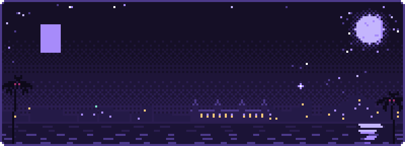
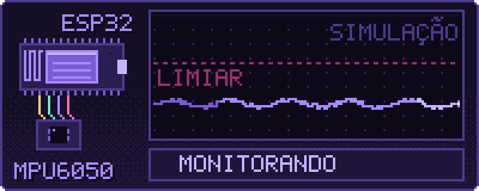
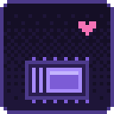
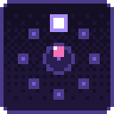
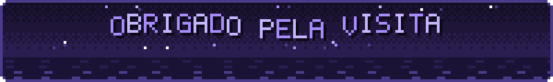

<p align="center">
  
</p>

<p align="center">
  
</p>

### `sobre_mim.ino`

```cpp
// Belém, PA · Estácio Belém · 2º semestre

struct Foco {
  const char* hardware = "ESP32, Arduino, sensores";
  const char* software = "C++, web (HTML/CSS/JS/PHP)";
  const char* ia       = "modelos locais com Ollama";
};

void setup() {
  Serial.begin(115200);
  Serial.println("olá, mundo");
}

void loop() {
  aprender();
  prototipar();
  documentar();   // o que funciona e o que quebrou
}
```

<p align="center">
  
</p>

### `em_destaque.log`

<p align="center">
  
</p>

**Detector de queda para idosos.** O ESP32 lê a aceleração do MPU6050 e procura o padrão de uma queda: queda livre, impacto acima do limiar e depois imobilidade. Quando o padrão se completa, ele envia um alerta.

<sub>* A animação é ilustrativa. Não mostra leitura real do sensor.</sub>

<p align="center">
  
</p>

### `serial_monitor`

<table>
  <tr>
    <td width="140" align="center"></td>
    <td>
      <b>Detector de queda</b><br>
      ESP32 + MPU6050 + IA para identificar quedas e avisar quem cuida.<br>
      <code>ESP32</code> <code>C++</code> <code>MPU6050</code>
    </td>
  </tr>
  <tr>
    <td width="140" align="center"></td>
    <td>
      <b>Roda de palavras</b><br>
      Seleção de palavras com joystick e sugestões contextuais.<br>
      <code>Arduino</code> <code>joystick</code> <code>IA</code>
    </td>
  </tr>
  <tr>
    <td width="140" align="center"></td>
    <td>
      <b>Sistema de inventário</b><br>
      Cadastro e controle de itens pela web.<br>
      <code>HTML</code> <code>CSS</code> <code>JS</code> <code>PHP</code>
    </td>
  </tr>
</table>

<p align="center">
  
</p>

### `ferramentas.h`

<p align="center">
  
  
  
  
  
  
  
  
  
  
  
  
</p>

### `contato`

<p align="center">
  <a href="https://www.linkedin.com/in/maykewendrell/"></a>
  <a href="mailto:maykewendrell2@gmail.com"></a>
  <a href="https://www.instagram.com/maykilovy/"></a>
</p>

<p align="center">
  
</p>
